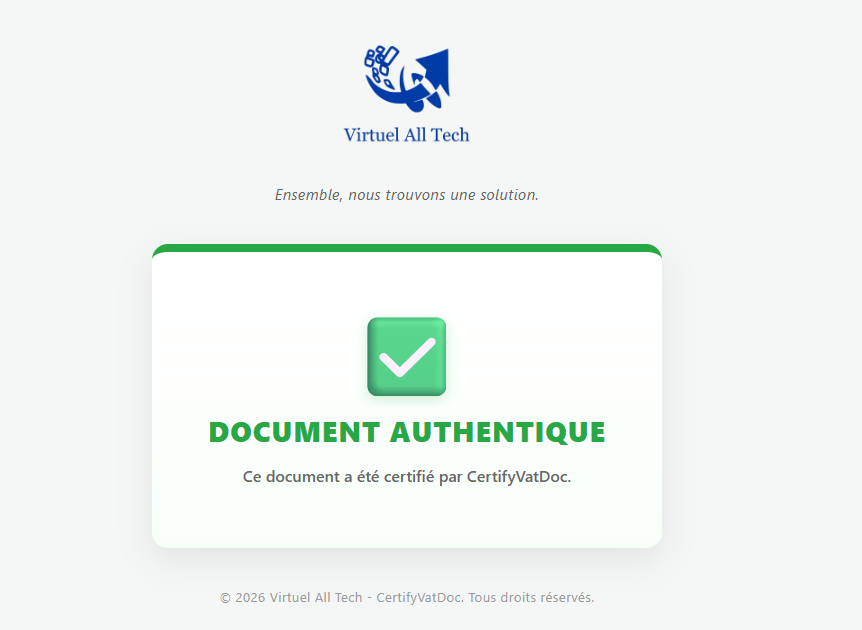

  
   
  <em>Ensemble, nous trouvons une solution.</em>

 

# CertifyVatDoc - Document Verification

**CertifyVatDoc** is a digital security solution developed by **Virtuel All Tech**. It provides a robust way to certify the authenticity of documents (PDFs, invoices, certificates) using cryptographic signatures and a verifiable QR code.

## 🎯 Project Goal

This repository contains the **verification web page** (Frontend). When a user scans the QR code on a certified document, they are redirected to this page, which instantly displays whether the document is authentic (green status) or has been tampered with (red status).

## ⚠️ Project Status

This project is currently in its **development phase (MVP)**.
*   ✅ The visual verification page is functional.
*   ⏳ The PDF reading engine (API) and database are under development.

---

  <em>Developed with a passion for securing digital trust in Africa.</em>

